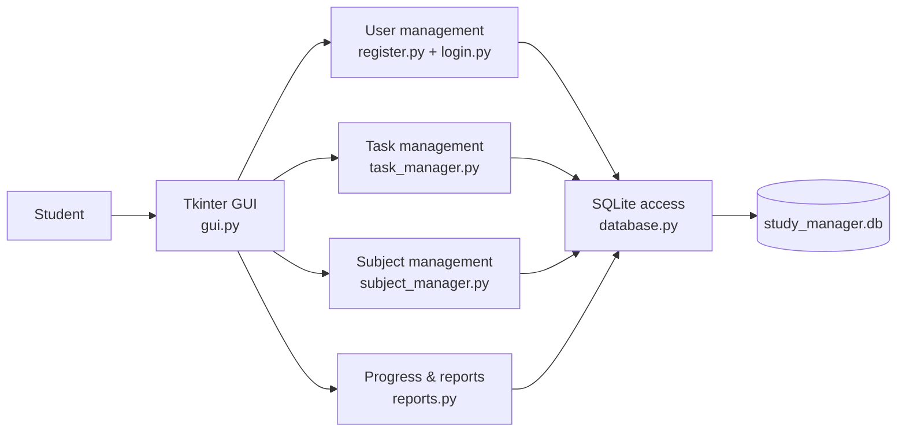
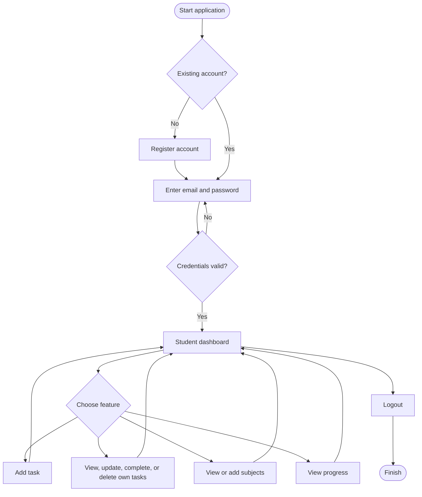
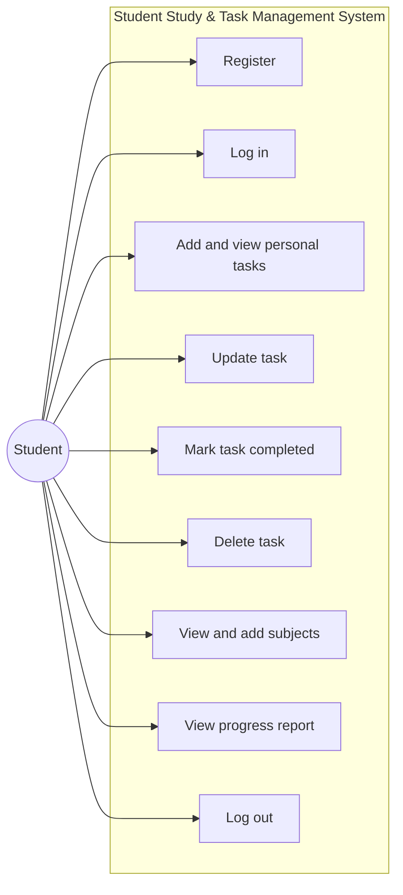
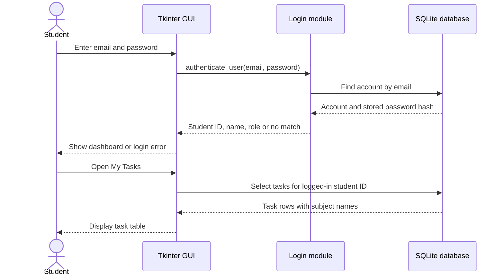
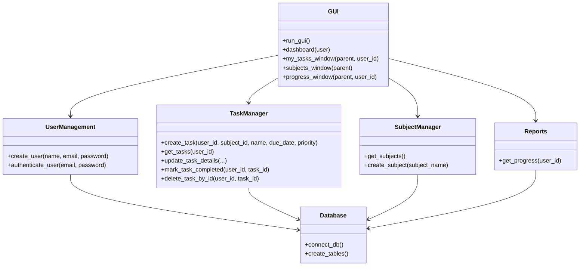
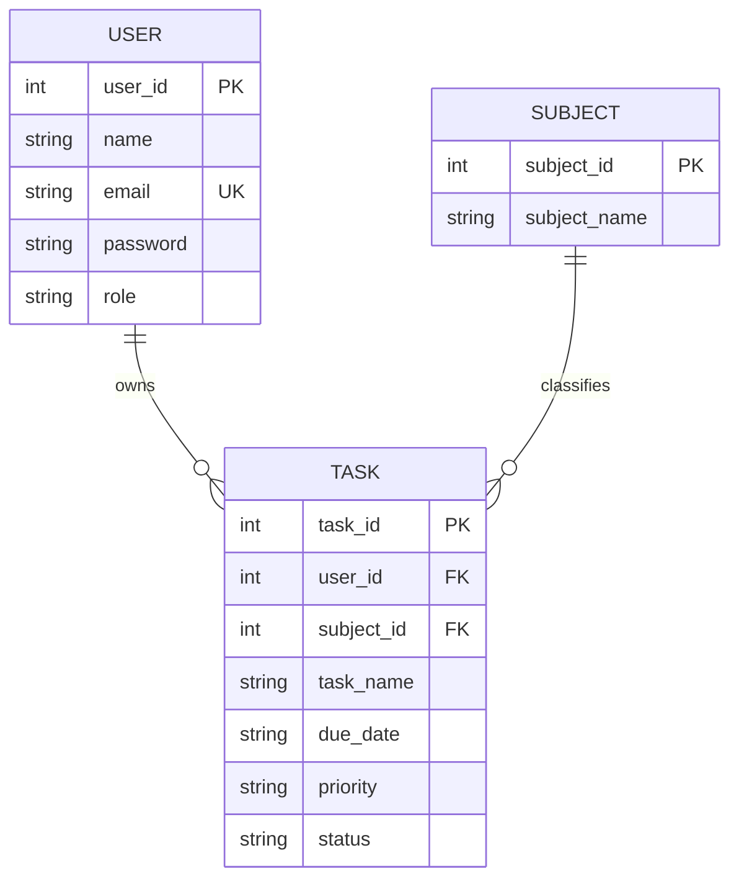

# System Design Diagrams

The Mermaid diagrams below describe the current desktop application and its intended data flow.

## 1. System Architecture Diagram

## 2. User Workflow Diagram

## 3. Use Case Diagram

## 4. Sequence Diagram

## 5. Class/Component Diagram

## 6. ER Diagram

A user can have zero or many tasks. A subject can be used by zero or many tasks. Every task is associated with one user and one subject in normal application use.
